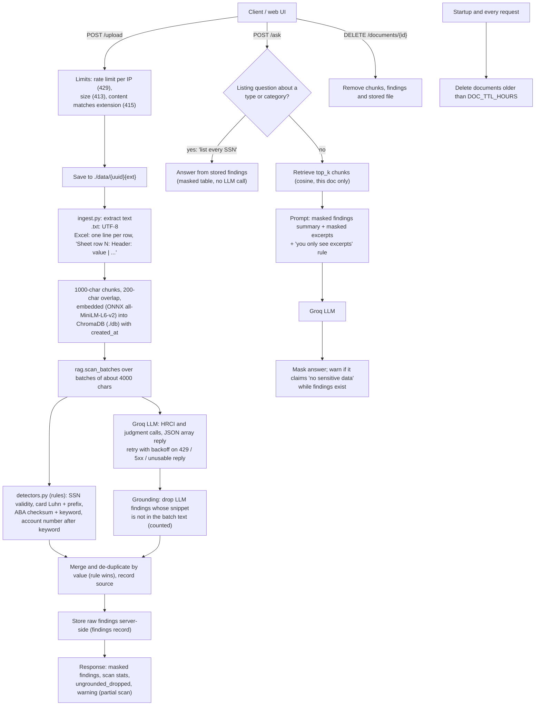

# RiskBot: HRCI / NPPI Detector

[](https://github.com/Kadaru242003/HRCI-NPPI-doc-finder/actions/workflows/tests.yml)

RiskBot is a small FastAPI service that flags sensitive data in uploaded **.txt** and **Excel** files:

- **HRCI** (Human Resources Confidential Information): compensation, performance problems, terminations and
  employment-related medical information.
- **NPPI** (Non-Public Personal Information): Social Security numbers, payment card numbers, bank routing numbers
  and bank account numbers.

Detection is **hybrid**:

- **Deterministic rules** find structured NPPI using checksums and validity rules.
- **An LLM** served by [Groq](https://groq.com) handles HRCI and anything that needs judgment. It uses
  `openai/gpt-oss-120b` by default, configurable with `GROQ_MODEL`.
- **Grounding:** LLM findings that don't quote the file are dropped.

Sensitive values are **masked** in every response. A chat endpoint answers questions about the document. Category
questions ("list every SSN") are answered from the whole-file findings, and other questions use
retrieval-augmented generation over the most relevant chunks. Documents are deleted on request or after a TTL.

Quality is measured on a labeled synthetic benchmark by `scripts/evaluate.py` (see [Evaluation](#evaluation)).
Peak memory is measured by `scripts/measure_memory.py` (see [Memory](#memory)).

<p align="center">
  
</p>

---

## How it works



### Detection

- **Rules (`detectors.py`)** run on every batch. Each finding has `"source": "rule"`.

  | Category | Rule |
  | --- | --- |
  | `ssn` | 3-2-4 digits with one consistent separator; area not 000, 666 or 900-999; group not 00; serial not 0000 |
  | `credit_card` | 13 to 19 digits, a major network prefix, and a passing Luhn check |
  | `routing_number` | 9 digits, a valid ABA prefix and checksum, and a routing keyword (`routing`, `ABA`, `RTN`, `transit`) just before |
  | `bank_account` | 6 to 17 digits directly after an account keyword (`account`, `acct`, `a/c`, `checking`, `savings`) |

- **LLM** (`rag._detect_batch`):
  - The prompt lists the eight categories and asks for a JSON array only, or `[]`.
  - The parser accepts fences, prose and `<think>` blocks around the array.
  - Categories are mapped onto the canonical eight. Each finding has `"source": "llm"`.
- **Category check**: an LLM finding that fits none of the eight categories (for example `"other"`, or a bare
  person's name) is dropped and counted in `uncategorized_dropped`.
- **Grounding**: an LLM finding is kept only if its `text_snippet` appears in the text it was given after
  collapsing whitespace. Dropped findings are counted in `ungrounded_dropped`.
- **Merge**: findings are de-duplicated by value. NPPI values compare by digits, so `SSN: 123-45-6789` and
  `123 45 6789` are one value. A rule finding wins over an LLM finding.
- **Retries**: each LLM batch is retried up to `LLM_MAX_RETRIES` times. Retries cover HTTP 429 (waiting for
  `Retry-After`), 5xx, connection errors, timeouts and unusable replies. The backoff is exponential, capped per
  wait. Permanent errors such as `404 model_not_found` fail at once.
- **Failures are never "clean"**:
  - If every LLM batch fails, `/upload` returns `502` and stores no findings.
  - If some fail, it returns `200` with a `warning`, and `scan` reports how many parts were scanned. The UI shows
    a highlighted **PARTIAL SCAN** status.

### Masking

- **`/upload` responses** contain only masked snippets:
  - NPPI keeps the last 4 digits: `***-**-6789`, `**** **** **** 1111`, `******9381`.
  - HRCI snippets have every digit masked (`Salary: $***,***`) and person names reduced to initials
    (`Jordan Smith` becomes `J. S.`). Other words stay readable.
- **`/ask`**:
  - The excerpts are masked before they reach the LLM.
  - The answer is masked again. This pass matches the stored values in any spacing, dash or comma format, plus
    anything the rules recognize.
- **Raw values** stay only in the server-side findings record, which needs them for this masking, and are deleted
  with the document.

### `/ask`

- **Category questions** contain a listing word (`show`, `list`, `only`, `every`, `how many`, `which`, ...) and
  name a type or category (HRCI, NPPI, SSN, card, routing, account, salary, performance, termination, medical).
  They're answered deterministically from the stored whole-file findings, as a masked Markdown table, with
  `route: "findings"`. There's no similarity search and no LLM call.
- **Other questions** use retrieval, with `route: "retrieval"`:
  - The question is embedded and the `top_k` most similar chunks of this document are retrieved.
  - The prompt carries a compact masked summary of the whole-file findings (type, category, count, examples).
  - The prompt also tells the model it only sees excerpts and must not claim the document has no sensitive data
    from them. If an answer still says so while findings exist, the response carries a `warning`.
- **Rendering:** the web UI renders answers as Markdown with vendored, SRI-pinned marked and DOMPurify
  (`static/vendor/`). It shows raw HTML as text and keeps only http(s) and mailto links, which open in a new tab.
  `static/markdown-test.html` demonstrates hostile answers rendering harmlessly.

### Privacy and limits

- **Logging:** logs carry counts and IDs only, never document text, model output or findings. A test plants
  sensitive values and checks every log line.
- **Retention:**
  - `DELETE /documents/{doc_id}` removes a document's chunks, findings and stored file. Only canonical UUIDs are
    accepted.
  - Documents older than `DOC_TTL_HOURS` are deleted on startup and before every request.
  - The UI has a **Delete document** button.
- **Uploads:**
  - The size limit is `MAX_UPLOAD_MB`. An oversized request is rejected before the body is read.
  - Content must match the extension: an `.xlsx` must be an Excel ZIP, an `.xls` must carry the OLE2 signature,
    and a `.txt` must be UTF-8 with no binary data.
- **Rate limits:** per-IP limits on `/upload` and `/ask` return `429` with `Retry-After`.

### Embeddings and storage

- **Embedder:** `store.py` owns one `chromadb.PersistentClient` (`./db`) and ChromaDB's bundled ONNX build of
  `all-MiniLM-L6-v2`. That build applies the same tokenizer, 256-token truncation, mean pooling and
  normalization as sentence-transformers, so PyTorch isn't needed.
- **Loading:** the model loads lazily, once per process, on the first upload or question. It's downloaded to
  `~/.cache/chroma` and checked against a SHA-256 hash. Texts are embedded one at a time to keep peak memory low.
- **Records:** chunks (`kind: "chunk"`) and one findings record per document (`kind: "findings"`) share a
  collection and carry `created_at`. Retrieval filters on `doc_id` and `kind: "chunk"`, so findings records and
  other documents are never retrieved.

### Project layout

```
api.py              FastAPI app: /upload, /ask, DELETE /documents/{id}, limits and retention middleware
detectors.py        Rule-based NPPI detectors (SSN, card, routing, account)
rag.py              Hybrid detection, grounding, retries, merge, retrieval, /ask routing and summaries
masking.py          Masking of findings and free text
ingest.py           Text extraction (txt, Excel with headers), chunking, storing in Chroma
store.py            Persistent Chroma client and the lazily loaded ONNX embedder
retention.py        DELETE and TTL expiry
limits.py           Upload size and content checks, per-IP rate limiter
static/             Single-page UI, Markdown rendering, vendored libraries
eval/               Labeled synthetic benchmark (build_benchmark.py, labels.json, protocol)
scripts/            evaluate.py (quality), measure_memory.py (peak memory)
tests/              pytest suite; Groq and the embedding model are mocked
```

---

## Setup

Requires **Python 3.10** (see `runtime.txt`) and a Groq API key (the free tier is enough).

```bash
git clone https://github.com/Kadaru242003/HRCI-NPPI-doc-finder.git
cd HRCI-NPPI-doc-finder

python3.10 -m venv venv
source venv/bin/activate
pip install -r requirements.txt
cp .env.example .env   # then set GROQ_API_KEY
```

The app refuses to start without `GROQ_API_KEY`. The code doesn't load `.env` itself, so pass it to uvicorn with
`--env-file`, as shown below, or export the variable. `.env` is git-ignored.

Optional settings, read from the environment:

| Variable | Default | Meaning |
| --- | --- | --- |
| `GROQ_MODEL` | `openai/gpt-oss-120b` | Groq model for detection and `/ask` |
| `CHROMA_DIR` | `./db` | Where the Chroma database is stored |
| `RAG_TOP_K` | `5` | Chunks `/ask` retrieves when the request has no `top_k` |
| `DETECT_BATCH_CHARS` | `4000` | Max characters of chunk text per detection LLM call |
| `LLM_MAX_RETRIES` | `3` | Retries per detection batch |
| `DOC_TTL_HOURS` | `24` | Documents older than this are deleted; `0` disables expiry |
| `MAX_UPLOAD_MB` | `2` | Maximum upload size |
| `RATE_LIMIT_UPLOADS_PER_MINUTE` | `10` | Per client IP; `0` disables |
| `RATE_LIMIT_ASKS_PER_MINUTE` | `30` | Per client IP; `0` disables |

## Running

```bash
uvicorn api:app --env-file .env
```

Run from the repository root, with a single worker. The web UI is at <http://localhost:8000/static/index.html>,
and the API docs are at <http://localhost:8000/docs>.

## API

### `POST /upload`

Multipart form with one field, `file` (`.txt`, `.xlsx` or `.xls`). Example with synthetic data:

```text
Employee: Jane Doe
SSN: 123-45-6789
Salary: $102,000
Notes: placed on a performance improvement plan.
```

Example response. This is an illustration, not a measurement: the LLM's items and confidences vary between
runs, while rule confidences are fixed in `detectors.py`.

```json
{
  "doc_id": "3f1c9a5e-8a1b-4a53-9c0e-2b6f7d1e4a90",
  "indexed_chunks": 1,
  "findings": [
    { "type": "NPPI", "text_snippet": "***-**-6789", "category": "ssn", "confidence": 0.97, "source": "rule" },
    { "type": "HRCI", "text_snippet": "Salary: $***,***", "category": "compensation", "confidence": 0.95, "source": "llm" },
    { "type": "HRCI", "text_snippet": "placed on a performance improvement plan", "category": "performance", "confidence": 0.9, "source": "llm" }
  ],
  "ungrounded_dropped": 0,
  "uncategorized_dropped": 0,
  "scan": { "total_batches": 1, "scanned_batches": 1, "failed_batches": 0, "retries": 0 },
  "warning": null
}
```

| Case | Result |
| --- | --- |
| Too many uploads from one IP | `429` with `Retry-After` |
| File larger than `MAX_UPLOAD_MB` | `413` |
| Content doesn't match the extension (e.g. a PDF named `.txt`) | `415` |
| Extension not `.txt` / `.xlsx` / `.xls` | `400` |
| Excel file that can't be read | `400` `Unable to open Excel file: ...` |
| Every LLM batch fails (e.g. a retired model) | `502` with `detail` (names the model and reason), `doc_id`, `indexed_chunks`; no findings stored |
| Some LLM batches fail | `200` with findings, `warning` and `scan.failed_batches` |

If you see `does not exist`, Groq has retired the model: set `GROQ_MODEL` to a current one.

### `POST /ask`

Form fields: `doc_id`, `question`, and an optional `top_k` (1 to 50). The response has `answer` (masked),
`route` (`findings` or `retrieval`), `retrieved_chunk_ids` and `warning`.

| Case | Result |
| --- | --- |
| Too many questions from one IP | `429` with `Retry-After` |
| Unknown `doc_id` | `200` `{"answer": "No document found.", ...}`, no LLM call |
| LLM call fails or returns an empty answer | `502` with `detail` |
| Answer cut off at the output token limit | `200` with a `warning` |
| Answer claims "no sensitive data" while findings exist | `200` with a `warning` |

### `DELETE /documents/{doc_id}`

Removes the document's chunks, findings record and stored file. The response is
`{"doc_id", "deleted_chunks", "deleted_findings", "deleted_files"}`. Unknown or already expired documents return
`404`, and a malformed id returns `400`.

---

## Evaluation

`scripts/evaluate.py` measures detection quality on the held-out split of a labeled synthetic benchmark.

- **Same code as the app:** it runs the app's own extraction, chunking, batching and `rag.scan_batches`.
- **Benchmark (`eval/`):** 48 documents. Half are held out and never used for tuning. 12 are `.xlsx`, and there
  are hard negatives such as phone numbers, order IDs that pass the ABA checksum, Luhn-valid tracking numbers,
  dates and invalid SSNs.
- **Labels first:** the labels and matching rules (`eval/README.md`) were committed before any detector was
  written.
- **Cached replies:** LLM replies are cached in `eval/llm_cache/`, so reruns are free. Uncached calls are paced
  for the Groq free tier.
- **Kept current:** the table below is generated by the script, and CI fails if it's out of date.

<!-- eval-table:start -->
Split: **heldout**, 24 documents (18 .txt, 6 .xlsx), model `openai/gpt-oss-120b`. P / R / F1 per category.

| Type | Category | Labels | LLM only | Rules only | Hybrid (rules + LLM + grounding) |
| --- | --- | ---: | --- | --- | --- |
| NPPI | ssn | 24 | not run | 1.00 / 1.00 / 1.00 | not run |
| NPPI | credit_card | 6 | not run | 1.00 / 1.00 / 1.00 | not run |
| NPPI | routing_number | 24 | not run | 0.96 / 1.00 / 0.98 | not run |
| NPPI | bank_account | 25 | not run | 1.00 / 0.96 / 0.98 | not run |
| HRCI | compensation | 24 | not run | n/a / 0.00 / 0.00 | not run |
| HRCI | performance | 11 | not run | n/a / 0.00 / 0.00 | not run |
| HRCI | termination | 8 | not run | n/a / 0.00 / 0.00 | not run |
| HRCI | medical | 9 | not run | n/a / 0.00 / 0.00 | not run |
|  | all (micro) | 131 | not run | 0.99 / 0.60 / 0.74 | not run |

LLM columns: **not run**. Some LLM replies are not in `eval/llm_cache/` and no `GROQ_API_KEY` was available when this table was generated. Run `GROQ_API_KEY=... python scripts/evaluate.py --write-readme` to fill them in.

Generated by `python scripts/evaluate.py --write-readme`. Matching rules: `eval/README.md`.
<!-- eval-table:end -->

How to read this table:

- **LLM columns:** these need a Groq API key, and none was available when the table was generated. To fill them
  in, run `GROQ_API_KEY=... python scripts/evaluate.py --write-readme` locally, or the manual **evaluate**
  workflow with a `GROQ_API_KEY` repository secret. Then commit `README.md` and `eval/llm_cache/`.
- **Rules only:** the rules cover NPPI only, so their HRCI recall is 0 by design. HRCI is the LLM's job.
- **The benchmark is synthetic and template-generated.** Near-perfect rule scores on it show the rules match
  their specification. They don't show real-world accuracy: real documents use formats the templates don't
  (unformatted SSNs, accounts without a keyword, international numbers).

## Memory

`scripts/measure_memory.py` starts the real server (`uvicorn api:app`, one worker) and reads its peak resident
memory (`VmHWM`) after startup, after one upload and after one `/ask`.

- The embedding model is real.
- Groq is replaced by a tiny local fake that answers `[]`, so no LLM request leaves the machine.
- CI runs it on every push and fails above 350 MB. Render's free tier has 512 MB.

Output of `python scripts/measure_memory.py` (Linux, Python 3.10, model already cached):

```
Peak RSS of the uvicorn process (VmHWM), limit 350 MB:
    139.2 MB  startup
    286.1 MB  + upload of 10,000 chars (13 chunks, 6.7s incl. any model download)
    286.1 MB  + one /ask
OK: peak 286.1 MB
```

Output of `python scripts/measure_memory.py --chars 100000 --limit-mb 512`:

```
Peak RSS of the uvicorn process (VmHWM), limit 512 MB:
    139.4 MB  startup
    316.8 MB  + upload of 100,000 chars (125 chunks, 3.0s incl. any model download)
    316.8 MB  + one /ask
OK: peak 316.8 MB
```

## Tests

```bash
pip install -r requirements-dev.txt
python -m playwright install chromium   # for the browser tests
pytest
```

The suite needs no API key and no network:

- The Groq client and the embedding model are mocked.
- Sockets are blocked.
- ChromaDB runs for real in a temporary directory per test.
- Browser tests drive the real UI in Chromium, with the backend faked through request routing.

Coverage by file:

| File | What it checks |
| --- | --- |
| `test_detectors.py` | SSN validity ranges, Luhn and network prefixes, ABA checksum and keyword, account keywords, rule-over-LLM merge |
| `test_grounding.py` | Invented snippets are dropped and counted; whitespace-only normalization |
| `test_masking.py` | No raw value anywhere in `/upload` JSON, in the `/ask` prompt, or in the answer, even when the model reformats values |
| `test_ask_consistency.py` | Findings summary in the prompt; the "says no confidential data while findings exist" regression |
| `test_category_routing.py` | "list every SSN" and "show only NPPI" use stored findings, with no similarity search and no LLM call |
| `test_logging.py` | Planted sensitive values never appear in any log line, including on failure paths |
| `test_retention.py` | DELETE removes chunks, findings and files; TTL expiry on startup and per request |
| `test_limits.py` | `413`, `415` (content sniffing), `429` per IP with `Retry-After` |
| `test_retries.py` | Retry-After honored, exponential backoff, no retry on permanent errors |
| `test_excel.py` | "Header: value" with sheet names; header-less sheets |
| `test_evaluate.py` | Label integrity, matching rules, README table is current |
| `test_ui_markdown.py` | Sanitized Markdown, Delete button, partial-scan display |

`test_api.py`, `test_rag.py`, `test_llm_errors.py`, `test_parser.py` and `test_store.py` cover the original
endpoints, retrieval, persistence, model errors and the embedder.

CI (`.github/workflows/tests.yml`) runs on every push and pull request:

1. Checks that PyTorch isn't installed.
2. Runs the tests, including the browser tests.
3. Runs `scripts/measure_memory.py`.

---

## Limitations

These describe what the code does today.

- **The LLM's quality isn't measured yet.** The LLM-only and hybrid columns of the evaluation table say
  "not run" until the script runs with a Groq API key (see [Evaluation](#evaluation)). The prompt and parser are
  tested against mocked replies only.
- **The benchmark is synthetic.** It's generated from templates, so scores on it overstate real-world accuracy,
  especially for the rules.
- **The rules only cover formatted values with context.** An unformatted 9-digit SSN, a routing number without a
  routing keyword, or an account number without an account keyword is left to the LLM.
- **Document text is sent to a third-party API.** Detection sends each batch of raw text to Groq; only `/ask`
  excerpts are masked first. Use synthetic or approved data only.
- **Masking only covers what was detected.** A value neither the rules nor the LLM found isn't masked in `/ask`
  answers. HRCI snippets keep their words (for example "performance improvement plan"); only digits and names are
  masked. Names are found by a heuristic (2 or 3 capitalized words that aren't common HR terms), so a lone first
  name, an all-caps name or a lowercase name isn't masked.
- **Data at rest isn't encrypted.** Chunks, the raw findings record (`./db`) and the uploaded file (`./data/`)
  stay on disk until deleted or expired. Documents indexed before this version have no `created_at`, so they
  don't expire automatically and must be deleted with `DELETE /documents/{doc_id}`.
- **There's no authentication.** Anyone who knows a document's id (a random UUID) can query or delete it.
- **Rate limits are per process and in memory.** They reset on restart. The client IP is the rightmost
  `X-Forwarded-For` entry, which is correct behind one proxy that appends it (as Render does). Without a proxy, a
  client can set that header itself.
- **Uploads are slow and can be partial.** LLM calls run one after another during the upload, and retries can
  wait up to 30 seconds each. If batches still fail, the scan is partial (reported in `scan` and `warning`).
- **The routing and consistency checks are keyword-based.** Unusual phrasing for a category question goes to
  retrieval. The "no sensitive data" warning is a pattern match and can miss paraphrases.
- **Retrieval can miss.** Free-form `/ask` answers only see the `top_k` most similar chunks, plus the findings
  summary.
- **Excel extraction:** formulas are read as their stored values, and header detection is a heuristic (a first
  row containing numbers isn't treated as a header).
- **Run a single process.** The embedded Chroma client and the in-memory rate limiter assume one uvicorn worker.
- **The first request after a deploy is slower.** On an ephemeral filesystem, the embedding model is downloaded
  again by the first upload or question after a restart.
- **The default model can be retired by Groq.** Uploads then return `502` naming the model; set `GROQ_MODEL` to
  a current one.
